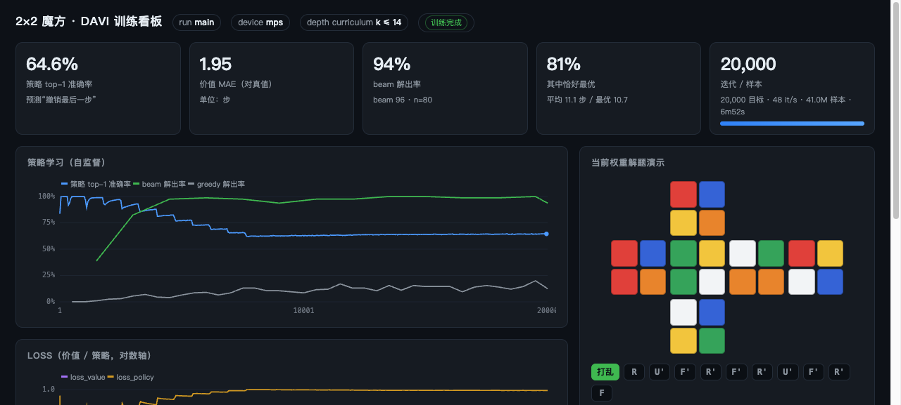
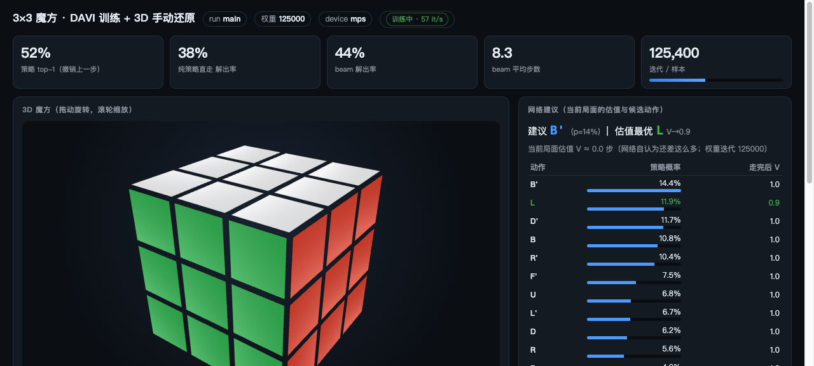

# rubik-davi

Learning to solve a Rubik's cube from scratch — DAVI-style value iteration plus a
self-supervised policy, with live training dashboards and a full 3D interactive cube.

从零学还原魔方：DAVI 式价值迭代 + 自监督策略，配实时训练看板与 3D 交互魔方。
训练 loss 里没有任何最短解标签——`oracle.py` 只当考卷，并在模块边界上与训练器隔离。




> **这不是生产级求解器。** 真要快，用两阶段（Kociemba）：`min2phase` / `rob-twophase`
> 毫秒级给出约 20 步解。这个项目回答的是另一个问题：**不用标签，网络能不能学会还原，
> 代价是什么。**

## 跑起来

```bash
pip install -r requirements.txt      # torch + numpy

./start.sh        # 2×2：训练 20k 迭代（M4 约 7 分钟）+ 2D 看板 → http://127.0.0.1:8849
./start3.sh       # 3×3：训练 + 3D 看板（拖拽旋转、手动拧、网络提示、自动还原）→ :8851
TRAIN=0 ./start.sh                   # 只看板，连已有 run
PORT=8850 RUN=runs/mine ./start.sh   # 换端口 / 换目录
```

看板按文件时间戳**热加载** `runs/<id>/model.pt`，训练还在跑也能拿最新权重上手。

## 方法

| 组件 | 作用 | 为什么 |
|---|---|---|
| **价值头** | 回归 cost-to-go `J(s) = min_a [1 + J(s')]`，`J(目标)=0`，从目标态 bootstrap（DAVI / DeepCubeA） | 稠密软标签，无任何真值；`min` 备份 |
| **策略头** | 预测“**撤销最后一步打乱**”的动作 —— 标签由随机游走自己产生 | 几百步就收敛；AlphaCube 式自监督 |
| **beam 搜索** | `f = g + V(s)` 或 `f = −Σ log p(a)`，按状态索引去重 | 网络只是启发式，搜索负责收敛 |
| ~~纯价值迭代~~ | ~~对 `V` 贪心~~ | 实测在单机上不收敛（见下） |

数据全部来自从还原态出发的随机游走，深度课程 `k = 4 → 20`，**每个样本独立采样**。

## 实测结果

### 2×2（完整跑完：20 000 迭代 / 6m52s / 41M 样本 / M4 MPS）

考卷：300 个**均匀随机**状态（平均最优 10.63 步，全空间 3 674 160 状态 BFS 枚举）：

| 求解器 | 解出率 | 平均步数 | 恰好最优 | 超出最优 |
|---|---|---|---|---|
| 纯策略贪心 | 14.7 % | 11.6 | 52 % | — |
| beam-policy w96 | 96.7 % | 11.24 | 71.4 % | +0.65 |
| **beam-policy w192** | **99.7 %** | 10.98 | 82.6 % | +0.35 |
| beam-value w96 | 92.7 % | 10.55 | **98.6 %**（已解出的样本中） | +0.03 |

价值头对真值距离 MAE ≈ 1.8 步、相关性 ≈ 0.13：它是个**弱**距离估计，
所以只有配上搜索才有效——这与 DeepCubeA 的结论一致。

### 3×3（完整跑完：300 000 迭代 / 91 分钟 / 230 M 样本 / M4 MPS，66 万参数）

打乱 8..20 步，每个深度 **20 个随机局面**，beam 搜索按状态去重（`n=20`，比例误差约 ±10 个百分点）：

| 打乱步数 | 8 | 10 | 12 | 14 | 16 | 18 | 20 |
|---|---|---|---|---|---|---|---|
| 解出率（beam 128） | 100 % | 100 % | 90 % | 70 % | 75 % | 45 % | 30 % |
| 平均解长 | 7.7 | 11.5 | 12.9 | 15.9 | 21.1 | 24.4 | 31.7 |
| 解出率（beam 256） | 100 % | 100 % | 95 % | 80 % | 85 % | 50 % | 45 % |

（14 与 16 步之间的非单调是 20 样本的噪声，不是真实现象；宽 beam 稳定把难档推高 5–15 pp。）
策略头自监督 top-1 = **55.5 %**（12 选 1，随机基线 8.3 %）。

**能力边界从训练中途的 ~12 步推进到 ~16 步**：12 步以内基本全解，20 步打乱能解掉 30–45 %。
3D 看板默认 12 步打乱，8/16/20 是显式难度选项，搜索失败一律标成失败。

**没有**突破边界的两件事也记下来：把 beam 从 32 加到 128 只推满边界内、不推边界本身；
从最优估值节点重启搜索在 ≥18 步时会乱走（价值头太弱，无法引导恢复）。

边界存在的原因：自监督标签“撤销最后一步”在深层**本身有歧义**——同一个状态可由很多游走出来，
“上一步”不是状态的函数。策略准确率饱和在 55 % 左右，beam 只能部分修补累积误差。
改成序列模型（预测整条逆路径，AlphaCube 的做法）是公认的下一步，本项目没有解决。

## 校验（数字可信的前提）

2×2 有可枚举真值；3×3 没有（4.3×10¹⁹ 状态），所以正确性靠**外部独立实现**（`pycuber`，仅开发依赖）：

| 校验项 | 2×2 | 3×3 |
|---|---|---|
| 全空间 BFS 距离表 | 3 674 160 状态、God's number 14、与公开 QTM 距离分布**逐项吻合** | 不可能 |
| 块级状态 vs 参考实现（40 条随机序列） | — | **40/40 完全一致** |
| 54 贴纸图 vs 参考实现（60 条随机序列） | — | **60/60 一致** |
| 群阶恒等式 | — | `order(R U)=105`、`order(R U')=63` ✓ |
| 不变量（扭转%3 / 翻转%2 / 奇偶） | — | 300 条序列 0 违反 |
| 贴纸 ↔ 状态 往返 | — | 20/20 |

复现：`pip install pycuber` 后跑 `python3 check3.py`、`python3 check3e.py`、`python3 derive_view.py`。

## 踩过并修掉的真 bug（值得抄走）

1. **Bellman 写成 `max`** 却给非目标步 +1 → 价值单调漂到上界、塌成常数。cost-to-go 是 `min`。
2. **一批样本共用同一串打乱** → 2048 个完全相同的状态。特征是评估均值落在整数上（10.0 / 5.0 / 2.0）。
3. **层符号全传 +1** → U/F 单转看着完美，D/L/B 转错层。
4. **R、L 方向整体反了** —— 单面比对看不出来（90° 之后该面本来就是纯色），
   只有群阶能抓：`order(R U)` 会给出 63 而不是 105。
5. **四个侧面贴纸视图水平轴全反** —— 穷举 8 组 (right, up) 轴、逐格比色才定位到。
6. **beam 回溯用 `paths[0]`** 而不是 `paths[i % W]` → 终端报“已还原”，画面却没还原。

## 已知限制

- 3×3 稳定解到约 12 步；16 步以上开始掉（20 步 30–45 %，见上），不是通用求解器。
- 价值头是弱启发式（2×2 上 MAE ≈ 1.8），只当排序信号用，别当距离。
- beam 是离线思考，不是实时：2×2 w32 约 0.9 ms/状态，3×3 w128 约 0.1 s/状态。
- 只有 MPS / CPU 训练代码，没有多卡；复现 DeepCubeA 量级的数字需要远超单机的算力。
- 看板是标准库 HTTP 服务、无鉴权，仅限本机。

## 目录

```
cube2.py  oracle.py  model.py  scorecard.py  train.py  serve.py  web/     # 2×2
cube3.py  model3.py  scorecard3.py  train3.py  serve3.py  web3/           # 3×3
check3.py check3e.py derive_view.py     # 与 pycuber 的交叉校验（开发用）
final_eval.py  final_eval3.py           # 终评报告
start.sh  start3.sh                     # 一键启动
docs/img  docs/results                  # 截图与评估 JSON
```

## 参考

- McAleer et al., *Solving the Rubik's Cube Without Human Knowledge* (2018) — DAVI
- Agostinelli et al., *Solving the Rubik's cube with deep reinforcement learning and search* (Nature MI 2019) — DeepCubeA / BWAS
- Takano, *Self-Supervision is All You Need for Solving Rubik's Cube* (2023) — AlphaCube
- Chervov et al., *A Machine Learning Approach That Beats Large Rubik's Cubes* (NeurIPS 2025) — CayleyPy

## License

MIT，见 `LICENSE`。
